# 🎬 Netflix Clone — End-to-End DevSecOps & CI/CD Pipeline on AWS EKS

<div align="center">

**Automated CI/CD · DevSecOps · Infrastructure as Code · Kubernetes · Monitoring**


</div>

---

## 📌 Project Overview

This project demonstrates an end-to-end **DevSecOps and CI/CD workflow** for deploying a Netflix Clone web application to **Amazon Elastic Kubernetes Service (Amazon EKS)**.

The solution combines Jenkins automation, SonarQube code analysis, Docker containerization, Terraform infrastructure provisioning, Kubernetes deployment, and Prometheus/Grafana monitoring.

The goal is to demonstrate practical skills in cloud infrastructure, continuous integration and delivery, application security, container orchestration, and observability.

## 🏗️ Architecture


### CI/CD workflow

```text
Developer
    |
    v
  GitHub
    |
    v
  Jenkins
    |
    +----> SonarQube Analysis
    |
    +----> Dependency / Security Checks
    |
    +----> Docker Build
                 |
                 v
        Container Registry
                 |
                 v
          Amazon EKS
          Kubernetes
                 |
                 v
       Netflix Clone Application
                 |
                 v
        Prometheus + Grafana
```

**Architecture components**

- **GitHub:** Source code management and version control.
- **Jenkins:** Pipeline orchestration and automated build stages.
- **SonarQube:** Static code analysis and quality gate evaluation.
- **Trivy / OWASP Dependency-Check:** Vulnerability scanning where configured.
- **Docker:** Application containerization.
- **Terraform:** Infrastructure provisioning as code.
- **Amazon EKS:** Managed Kubernetes control plane for application orchestration.
- **Amazon S3:** Storage for configured project artifacts or Terraform state.
- **Prometheus:** Metrics collection.
- **Grafana:** Monitoring dashboards and visualization.

## ✨ Key Features

### 1. Continuous Integration and Delivery

- Automated pipeline execution through Jenkins.
- Source code checkout from GitHub.
- Application dependency installation.
- Docker image build and publication.
- Deployment through Kubernetes manifests.

### 2. DevSecOps and Code Quality

- SonarQube static code analysis.
- Quality Gate integration.
- Trivy filesystem and container image scans.
- OWASP Dependency-Check integration where configured.
- Security checks incorporated into the delivery workflow.

### 3. Infrastructure as Code

Terraform configurations in `EKS_TERRAFORM/` manage the AWS infrastructure defined by the project.

- Amazon EKS infrastructure.
- Networking resources.
- Worker-node infrastructure, depending on the Terraform configuration.
- Repeatable infrastructure provisioning and teardown.

### 4. Container Orchestration

Kubernetes manifests in `Kubernetes/` define the application deployment and service configuration.

- Application Deployment.
- Kubernetes Service.
- Container image configuration.
- Integration with the Amazon EKS cluster.

### 5. Monitoring and Observability

- Prometheus metrics collection.
- Node Exporter host metrics.
- Grafana dashboards.
- Jenkins build and deployment notifications when configured.

## 🧰 Technology Stack

| Category | Technologies |
|---|---|
| Frontend | React, TypeScript, Vite |
| Runtime and packages | Node.js, npm / Yarn |
| Source control | Git, GitHub |
| CI/CD | Jenkins |
| Code quality | SonarQube |
| Security scanning | Trivy, OWASP Dependency-Check |
| Containerization | Docker |
| Infrastructure as Code | Terraform |
| Cloud platform | AWS EC2, EKS, S3, IAM |
| Orchestration | Kubernetes, kubectl |
| Monitoring | Prometheus, Node Exporter, Grafana |

## 📂 Project Structure

```text
Netflix-CICD-Project/
│
├── EKS_TERRAFORM/
│   └── # Terraform infrastructure configuration
│
├── Kubernetes/
│   └── # Deployment and Service manifests
│
├── public/
│   └── # Static application assets
│
├── src/
│   └── # React and TypeScript source code
│
├── Screenshot/
│   ├── Clusters.png
│   ├── EC2s.png
│   ├── EKSJOB.png
│   ├── Jenkins.png
│   ├── SonarQube.png
│   ├── Prometheus.png
│   ├── Grafana.png
│   ├── S3.png
│   ├── Moov2.png
│   ├── Moov3.png
│   └── Moovi1.png
│
├── Architecture CI_CD DevSecOps Netflix Clone.png
├── Dockerfile
├── package.json
├── vite.config.ts
└── yarn.lock
```

*The tree represents the expected project layout; adjust filenames if your local repository differs.*

## 🚀 Getting Started

### Prerequisites

Install and configure the following tools:

- AWS CLI
- Terraform
- kubectl
- Docker
- Node.js and npm or Yarn
- Git
- An AWS account with appropriately scoped IAM permissions

### 1. Clone the repository

Replace `YOUR_USERNAME` with the actual GitHub owner and use the repository's real URL.

```bash
git clone https://github.com/YOUR_USERNAME/Netflix-CICD-Project.git
cd Netflix-CICD-Project
```

### 2. Run the application locally

Using Yarn:

```bash
yarn install
yarn dev
```

Alternatively, using npm:

```bash
npm install
npm run dev
```

Check `package.json` for the available scripts.

### 3. Provision AWS infrastructure

```bash
cd EKS_TERRAFORM

terraform init
terraform validate
terraform plan
terraform apply
```

Review the execution plan and AWS costs before approving resource creation.

### 4. Connect to Amazon EKS

Configure the AWS CLI credentials and replace the placeholders with your actual cluster details.

```bash
aws eks update-kubeconfig \
  --name YOUR_CLUSTER_NAME \
  --region YOUR_AWS_REGION
```

Verify the cluster:

```bash
kubectl get nodes
kubectl get namespaces
```

### 5. Deploy the application

From the repository root:

```bash
kubectl apply -f Kubernetes/
```

Verify the deployment:

```bash
kubectl get deployments
kubectl get pods
kubectl get services
```

Check the Service output to identify the configured access method, such as a LoadBalancer address.

> **Note:** These commands assume that the Kubernetes manifests and Terraform outputs match your AWS configuration. Review image names, namespaces, and Service settings before deployment.

## 🔒 Security and Quality

Security is integrated into the CI/CD workflow through the configured analysis and scanning tools.

- **SonarQube:** Code analysis, code smells, and Quality Gate evaluation.
- **Trivy:** Filesystem and container image vulnerability scanning.
- **OWASP Dependency-Check:** Dependency vulnerability analysis when enabled.
- **IAM:** Use least-privilege permissions for AWS access.
- **Jenkins Credentials:** Store tokens, registry credentials, and other secrets securely.

**Important:** Never commit AWS access keys, API keys, passwords, Kubernetes configuration files containing credentials, or access tokens to GitHub. Use Jenkins Credentials or an appropriate secrets manager.

## 📊 Monitoring and Observability

### Prometheus

Prometheus collects metrics from configured targets, such as Node Exporter and supported application or cluster exporters.

### Grafana

Grafana visualizes collected metrics through dashboards to help monitor infrastructure and application health.

Monitoring coverage depends on the exporters, scrape targets, and dashboards configured in the environment.

## 📸 Project Screenshots

The following screenshots document different parts of the project.

### AWS Infrastructure

**EKS Cluster**

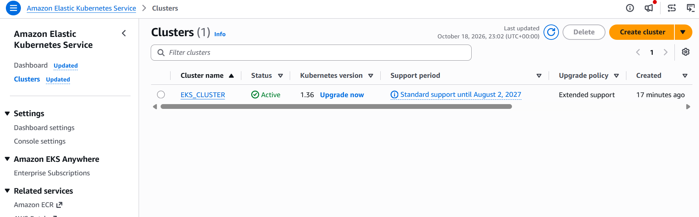

**EC2 Instances**

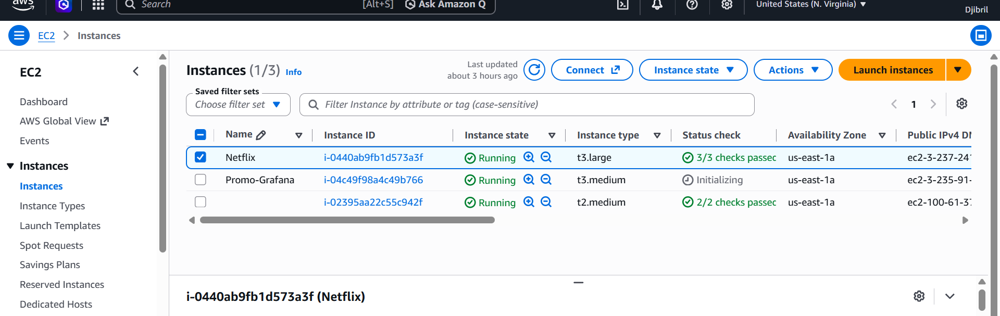

**S3 Configuration**

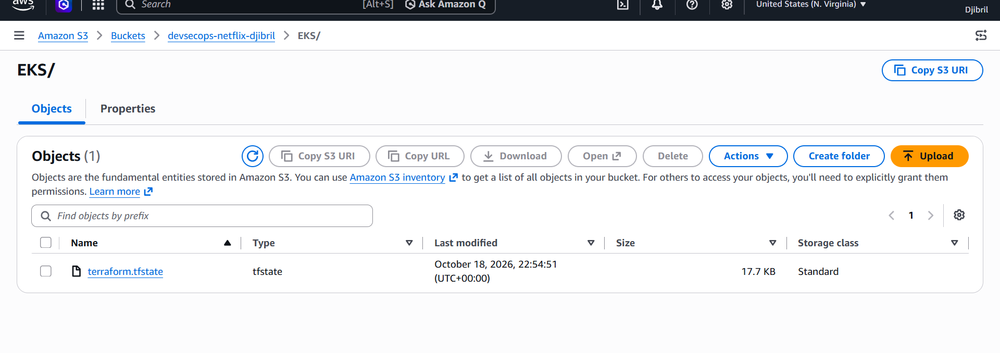

### CI/CD Pipeline

**Jenkins**

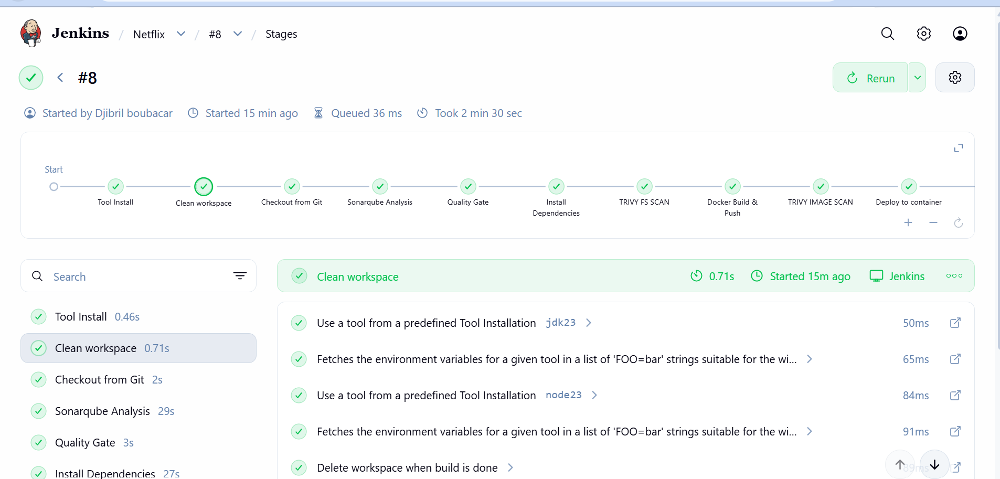

**EKS Provisioning Job**

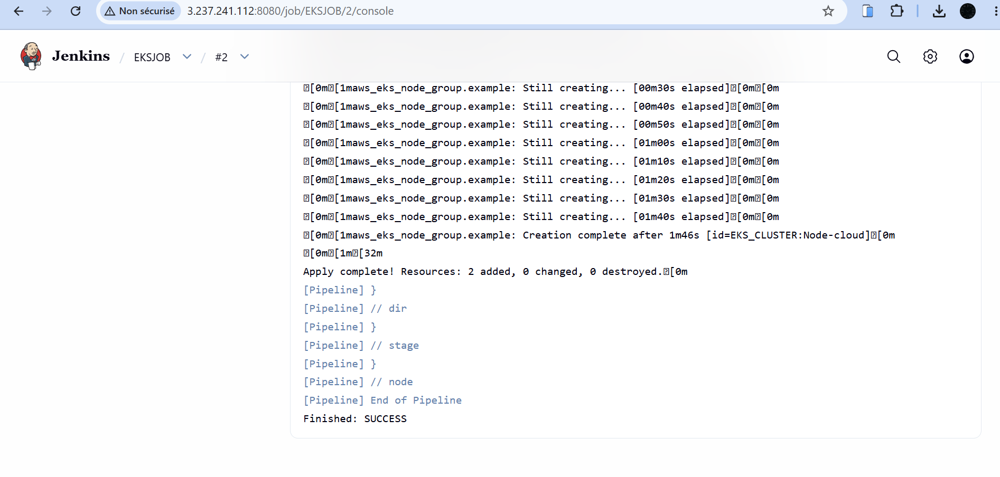

### Code Quality

**SonarQube Analysis**

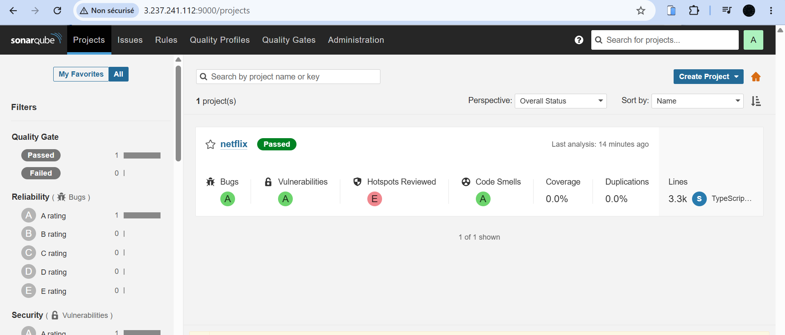

### Monitoring

**Prometheus**

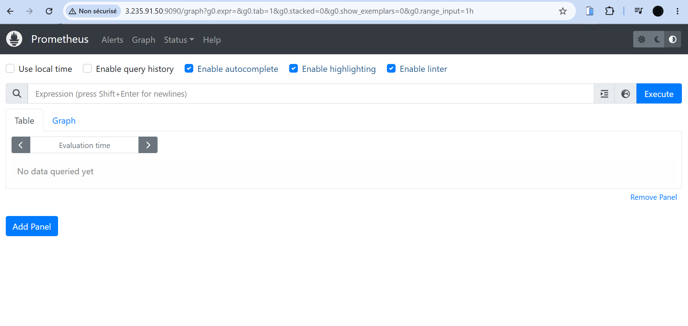

**Grafana Dashboard**

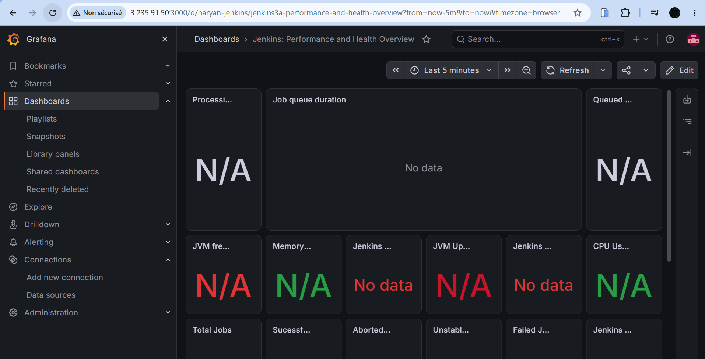

### Application Interface

**Netflix Clone — Screenshot 1**

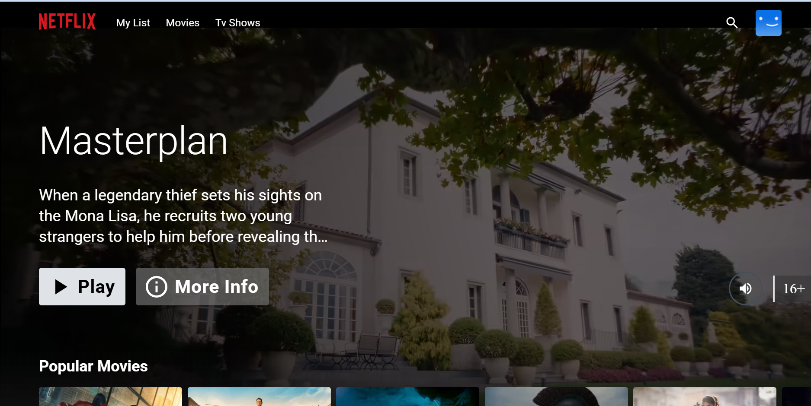

**Netflix Clone — Screenshot 2**

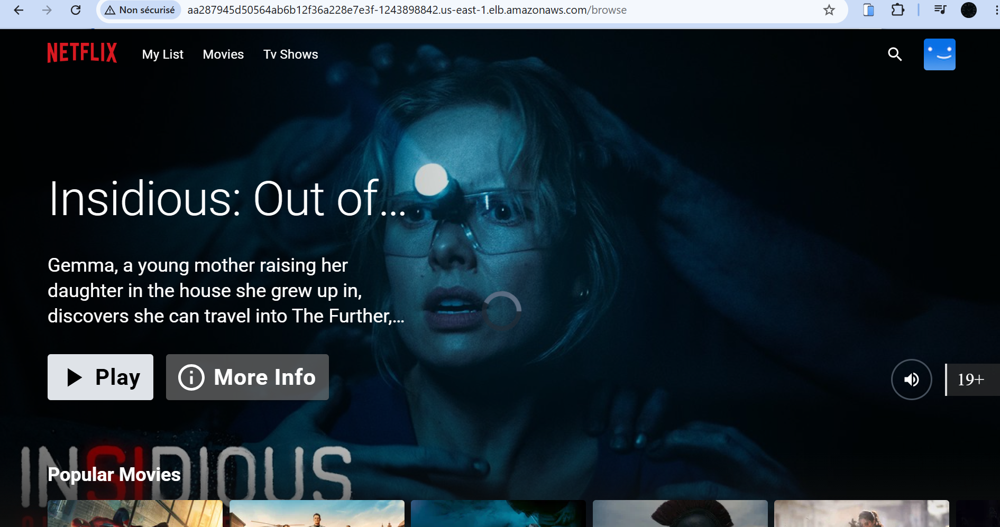

**Netflix Clone — Screenshot 3**

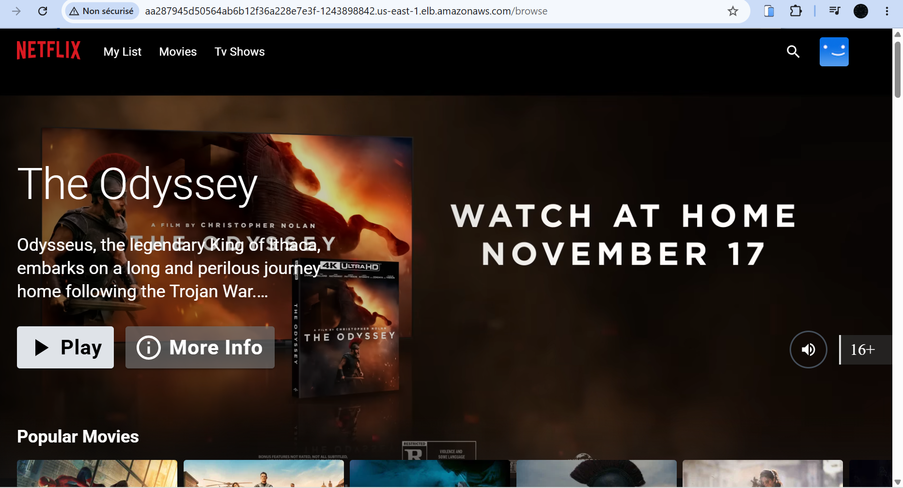

## 💰 AWS Cost Management

AWS resources used in this lab may incur charges, including EC2 instances, EKS, load balancers, storage, and networking services.

After completing the lab:

1. Review the resources created by Terraform.
2. Run `terraform destroy` from the appropriate Terraform directory when the infrastructure is no longer required.
3. Delete manually created resources that Terraform does not manage.
4. Verify that load balancers, storage volumes, and other billable resources have been removed.

Always review the destruction plan before confirming.

## 🎯 Learning Outcomes

This project demonstrates practical experience with:

- Designing a CI/CD workflow with Jenkins.
- Integrating code quality and security scanning.
- Building and publishing Docker images.
- Provisioning AWS infrastructure using Terraform.
- Deploying applications to Kubernetes on Amazon EKS.
- Configuring Prometheus and Grafana monitoring.
- Applying security and cost-awareness practices to cloud projects.

## 👨‍💻 Author

**BOUBACAR DJIBRILLA**

Software Engineer | AWS Cloud & DevOps | CI/CD | Infrastructure as Code

- **GitHub:** [boubacardjibrilla](https://github.com/boubacardjibrilla)

---

<div align="center">

**Built as a hands-on AWS Cloud, DevOps, and DevSecOps portfolio project.**

</div>
